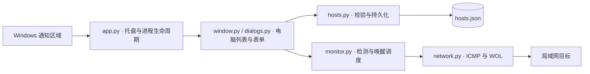

# 架构

Nwake 是一个 Windows 用户会话中的桌面进程。Qt 主线程负责窗口、托盘、状态和本地配置；任务池执行网络 I/O。没有服务端进程，也没有对外监听端口。

| 模块 | 职责 |
| --- | --- |
| `app.py` | 创建应用和托盘图标，获取当前用户的数据锁。关闭电脑列表时隐藏窗口，退出时停止定时器和网络任务。如果系统没有可用托盘，关闭窗口直接退出。 |
| `window.py`、`dialogs.py`、`theme.py` | 展示记录与检测信息，处理勾选、表单、确认及反馈。复用窗口与 EXE 图标、颜色与控件样式。 |
| `hosts.py` | 为 IPv4、MAC 和可选前缀提供统一校验；拒绝重复；存储失败时保留原配置。 |
| `monitor.py` | 用 8 个并发探测线程和一个独立发送线程执行有界 I/O；工作结果经 Qt 队列交回主线程，UI 无需等待网络超时。 |
| `network.py` | 编码 Magic Packet、发送广播，以及通过 Windows IP Helper 执行 IPv4 ICMP 探测。 |

列表变化后递增版本号。旧版列表未完成的探测允许结束，但结果会被丢弃；新列表随即开始探测。同一时间最多一轮探测、一个唤醒批次。隐藏窗口不会中断检测。实际退出会取消排队的探测，并停止向批次里尚未开始发送的目标发包。

配置只有程序成功写入后才更新界面。每用户的 `QLockFile` 防止两个实例同时改配置；保存采用同目录临时文件和原子替换。状态和勾选只留在进程中，重开软件时重新检测。
