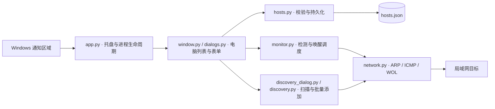

# 架构

Nwake 是一个 Windows 用户会话中的桌面进程。Qt 主线程负责窗口、托盘、状态和本地配置；任务池执行网络 I/O。没有服务端进程，也没有对外监听端口。

| 模块 | 职责 |
| --- | --- |
| `app.py` | 创建应用和托盘图标，获取当前用户的数据锁。关闭电脑列表时隐藏窗口，退出时停止网络任务。如果系统没有可用托盘，关闭窗口直接退出。 |
| `window.py`、`dialogs.py`、`theme.py` | 展示记录与检测信息，处理勾选、表单、确认及反馈。复用窗口与 EXE 图标、颜色与控件样式。 |
| `hosts.py` | 为 IPv4、MAC 和可选前缀提供统一校验；拒绝重复；存储失败时保留原配置。 |
| `monitor.py` | 用 8 个并发探测线程处理手动刷新，用一个独立发送线程处理唤醒。工作结果经 Qt 队列交回主线程，UI 无需等待网络超时。 |
| `discovery.py`、`discovery_dialog.py` | 选择本地网段，在独立任务池扫描设备，按 IP 与 MAC 去重，允许勾选结果后批量保存。切换网段或停止后丢弃之前的探测结果。 |
| `network.py` | 编码并发送 Magic Packet，通过 Windows IP Helper 执行 IPv4 ICMP 探测和 ARP 查询。 |

点击「刷新」开始一轮探测。列表变化后递增版本号，旧版列表中尚未交回的探测结果会被丢弃。同一时间最多一轮探测和一个唤醒批次。隐藏窗口后，已启动的手动探测可以在后台完成。实际退出会取消排队的探测，并停止向批次里尚未开始发送的目标发包。

配置只有程序成功写入后才更新界面。`hosts.json` 和 `nwake.lock` 都位于实际启动的 EXE 同级。`QLockFile` 防止同一目录内的实例同时改配置，保存采用同目录临时文件和原子替换。状态和勾选只留在进程中。重开软件后可点击「刷新」获取状态。
